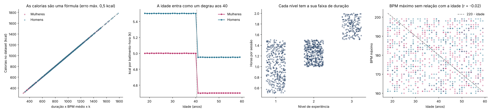
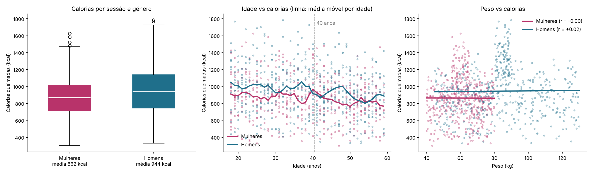
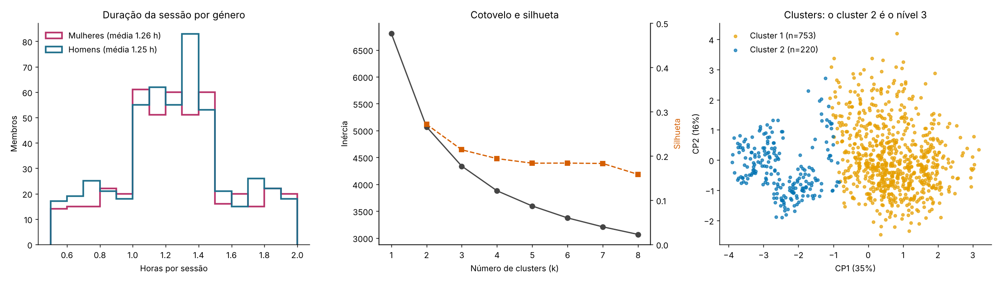
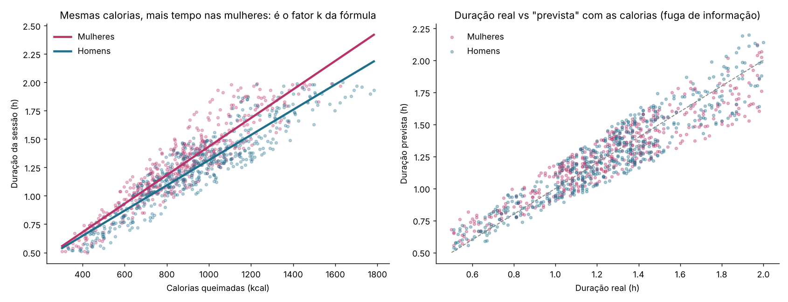

# O dataset de ginásio do Kaggle é sintético, e dá para provar

Peguei no `gym_members_exercise_tracking.csv` (973 membros, 15 colunas) para fazer a análise do costume: quem treina mais tempo, o que explica as calorias, que segmentos de membros existem. Ao fim de pouco tempo os resultados ficaram bons demais. Um R² de 1,00 não aparece em dados de pessoas.

Este repositório mostra como concluí que os dados foram gerados por regras e quais são essas regras. Nada aqui se aplica a ginásios reais. O que se aproveita é a forma de testar um dataset antes de construir modelos em cima dele.



## Como dei por isso

Tudo o que se segue sai de `src/gym_auditoria.py`.

1. As calorias são uma conta: `calorias = duração × BPM médio × k`, com k = 5,0 nas mulheres e 5,5 nos homens. O erro máximo nas 973 linhas é 0,5 kcal, que é o arredondamento à unidade.
2. A idade funciona como um interruptor. Aos 41 anos o k passa a valer 90% e fica igual até aos 59. Quem olhar só para a correlação entre idade e calorias (r = −0,16) vê um declínio gradual que não existe.
3. O nível de experiência define faixas sem exceções. No nível 3 toda a gente treina entre 1,5 e 2 horas, 4 a 5 dias por semana, com 10 a 20% de gordura. Dentro de cada faixa a duração é uniforme (Kolmogorov-Smirnov, p entre 0,42 e 0,70).
4. Faltam relações que existem em qualquer amostra de pessoas. O BPM máximo não desce com a idade (r = −0,02) e a gordura corporal também não sobe (r = 0,00). O IMC e a percentagem de gordura andam em sentidos opostos (r = −0,12).
5. O tipo de treino não muda nada. Yoga e HIIT têm as mesmas calorias, a mesma duração e o mesmo BPM (ANOVA com p entre 0,13 e 0,86).
6. Há 126 linhas (13%) que descrevem pessoas impossíveis: BPM médio acima do máximo, IMC abaixo de 16 ou acima de 40.

## O que isto faz às análises do costume

### Calorias por género, idade e peso



Homens e mulheres treinam o mesmo tempo (1,25 h contra 1,26 h por sessão, p = 0,70). Os homens queimam mais 82 kcal por sessão, mas só porque o k deles é 10% maior.

O peso parece contar (r = 0,10) e não conta. Dentro de cada género a correlação é zero. Os homens pesam mais e têm o k mais alto, e isso chega para criar a correlação global.

Uma regressão log-log devolve a fórmula: expoentes de 1,00 na duração e no BPM, fator ×1,10 para os homens e ×0,90 acima dos 40. O R² é 1,00 e não significa que o modelo seja bom. Significa que o alvo foi calculado a partir das outras colunas.

### Duração da sessão e clustering



Antes da sessão, o único preditor útil da duração é o nível de experiência (R² = 0,62 em validação cruzada, erro médio de 10 minutos). Não dá para passar daí: dentro de cada nível, o perfil físico tem R² negativo.

O K-Means escolhe k = 2 com silhueta de 0,27, que é fraca. O segundo cluster é o nível 3 (ARI de 0,87). Apresento-o como resultado negativo, porque os "segmentos" são uma coluna que já lá estava.

### Prever a duração com as calorias é fuga de informação



Com as calorias no modelo, o R² salta para 0,87, e para 1,00 se dividir pelo BPM e pelo k. Deixei este script no repositório como exemplo do erro: as calorias só existem depois da sessão e foram calculadas a partir da duração. As mulheres aparecem com sessões mais longas para as mesmas calorias, o que é outra vez o k.

### Robustez

Repeti os resultados só com as 847 linhas plausíveis. Nenhuma conclusão muda.

## Como correr

```bash
pip install -r requirements.txt
```

```bash
python src/gym_auditoria.py
```

Os outros três scripts (`gym_calorias.py`, `gym_clusters.py`, `gym_formula_invertida.py`) correm da mesma forma. Todos aceitam `--csv` e `--out`; por omissão leem de `data/` e gravam em `outputs/`.

## O que está em cada pasta

```
data/          CSV original
src/           os quatro scripts e gym_utils.py (carregamento e funções comuns)
outputs/       figuras geradas pelos scripts
docs/          dicionário de colunas, métricas e entidades
apresentacao/  resumo do projeto em PowerPoint
```

Os nomes curtos das colunas (`dur`, `cal`, `avgb`, `exp`...) estão em `src/gym_utils.py` e descritos em [docs/membros.md](docs/membros.md).

## Dados

[Gym Members Exercise Dataset](https://www.kaggle.com/datasets/valakhorasani/gym-members-exercise-dataset), publicado no Kaggle por valakhorasani. A licença está na página do dataset.

## Limites

Cada linha é um membro com uma sessão "típica". Não há datas nem várias sessões por pessoa, por isso não dá para estudar assiduidade, evolução ou abandono, que são as perguntas que interessam a quem gere um ginásio.

Com dados reais de acessos, a primeira coisa que faria era um modelo de abandono, e a segunda a ocupação por hora. Antes de qualquer das duas, corria uma auditoria como a deste projeto.
